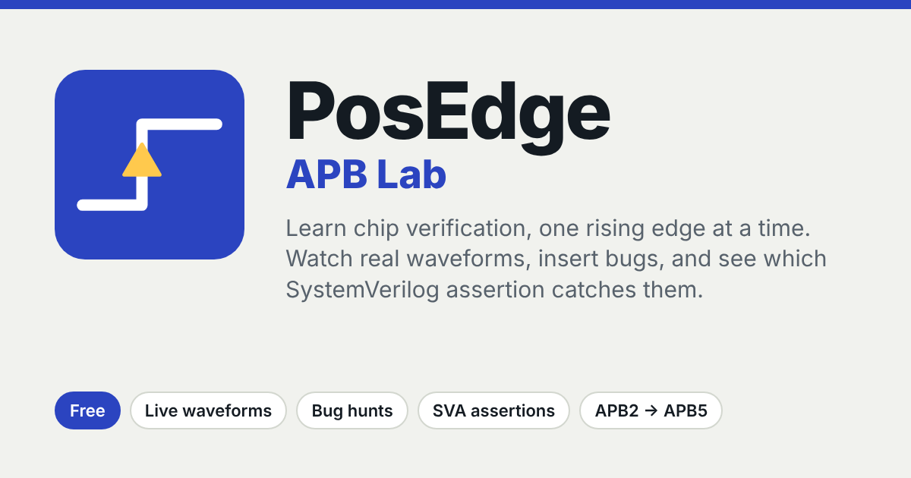

# PosEdge APB Lab

**Learn chip verification, one rising edge at a time.**

A free, interactive lab for the AMBA APB protocol and how to verify it. Watch real waveforms cycle by cycle, insert bugs, and see which SystemVerilog assertion catches them. It runs in your browser, with no login and no simulator licence.

### ▶ [Open PosEdge APB Lab](https://2023ht80265-prog.github.io/posedge/)

---

## Who it's for

- **Students and freshers** learning AMBA protocols for VLSI and design verification roles
- **Engineers preparing for DV interviews**, where APB timing, assertions and constraints come up again and again
- **Designers moving into verification**, who want to see how assertions, constraints and coverage connect to a real waveform
- **Teachers and trainers** who want a live waveform to use in class

## What you can do

| | |
|---|---|
| **Follow a roadmap** | Four stages, from the first signal to verification. You can learn the protocol in about 45 minutes. |
| **Watch any scenario** | 14 waveforms, from APB2 to APB5: wait states, errors, back-to-back transfers, byte strobes, protection, wake-up and reset. Every clock cycle is explained in plain English. |
| **Apply an assertion** | Pick any of 19 assertions and see where it checks the waveform, then step through each check. |
| **Insert a bug** | 14 real design and testbench bugs. Guess which assertion catches each one, then see the fix. |
| **Randomize with constraints** | Remove a constraint and see exactly what it changes, with the same seed. Watch coverage fill up as you run. |
| **Build your own assertion** | Combine a condition, a timing and a check. It's scored against every legal scenario and every bug. |
| **Draw it from memory** | 8 whiteboard-style drills: draw the timing yourself, then check it. |
| **Run it on a real simulator** | Export any waveform with its assertions as a SystemVerilog testbench for EDA Playground. |
| **See a full UVM testbench** | A complete UVM environment for an APB RAM, with an agent, scoreboard, coverage and two tests. [Open it on EDA Playground](https://edaplayground.com/x/YWUZ). |
| **Test yourself** | A 3-question checkpoint, a bug hunt, written exercises with solutions, and a 26-question quiz. |
| **Listen instead of reading** | A voice guide explains each section and how to use it. |

Your progress is saved in your own browser, so you can stop and continue later.

## Jump straight in

- Catch a bug: [the address that moves during a wait state](https://2023ht80265-prog.github.io/posedge/#bug-addr-wander)
- Watch a scenario: [a write with two wait states](https://2023ht80265-prog.github.io/posedge/#scenario-apb3-wait-w)
- Go further: [a full UVM testbench for an APB RAM](https://edaplayground.com/x/YWUZ), with a driver, monitor, scoreboard, coverage and two tests, ready to run on EDA Playground

## Coming next

AHB and AXI4-Lite labs, built the same way. [Tell me if you want them](https://forms.gle/NgSFStxCRiTXbccV9).

## Feedback

Found something unclear or wrong? Accuracy matters most, so please tell me through the [feedback form](https://forms.gle/NgSFStxCRiTXbccV9).

## Licence

© 2026 PosEdge. All rights reserved.

You're welcome to use the site for learning and teaching, and to share the link. Please don't copy, republish or sell the site or its content without permission. See [LICENSE](LICENSE).

---

*AMBA and APB are trademarks of Arm Limited. PosEdge is an independent learning project and is not affiliated with or endorsed by Arm. For normative wording, always refer to the Arm AMBA APB Protocol Specification.*
